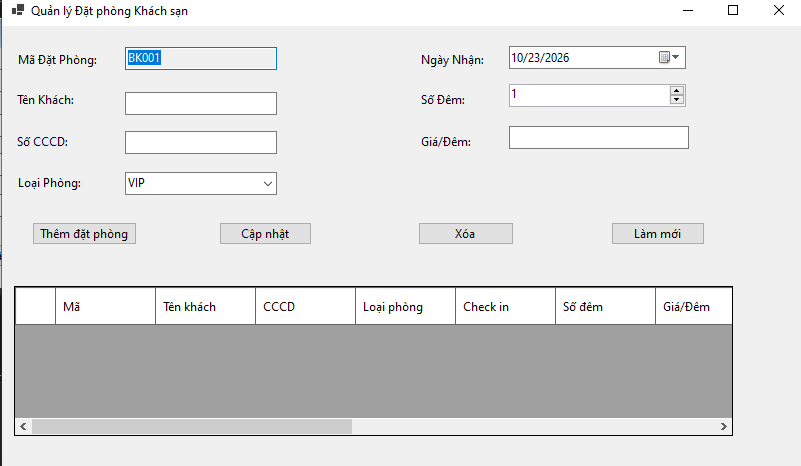
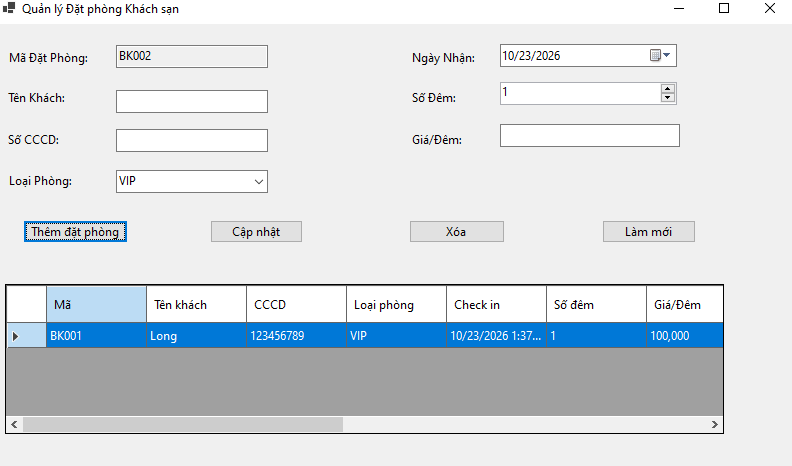
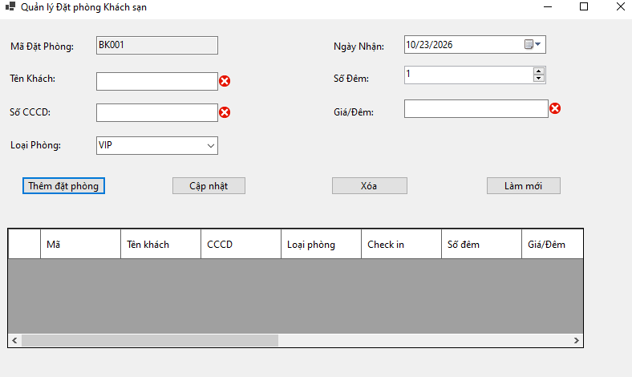
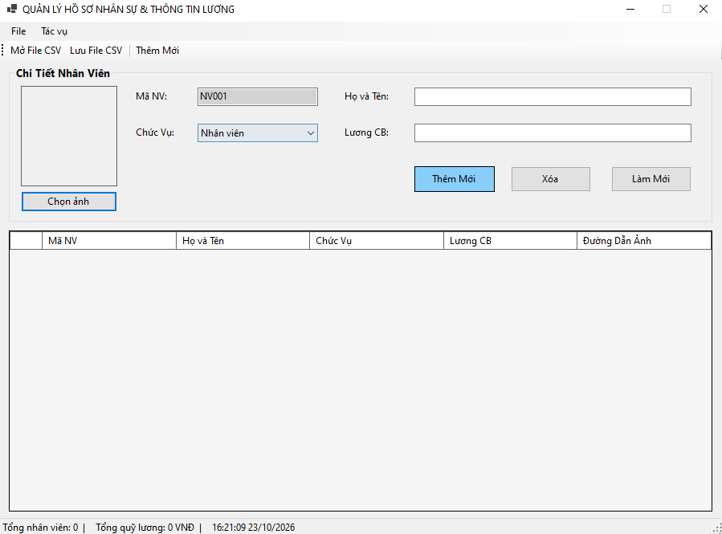
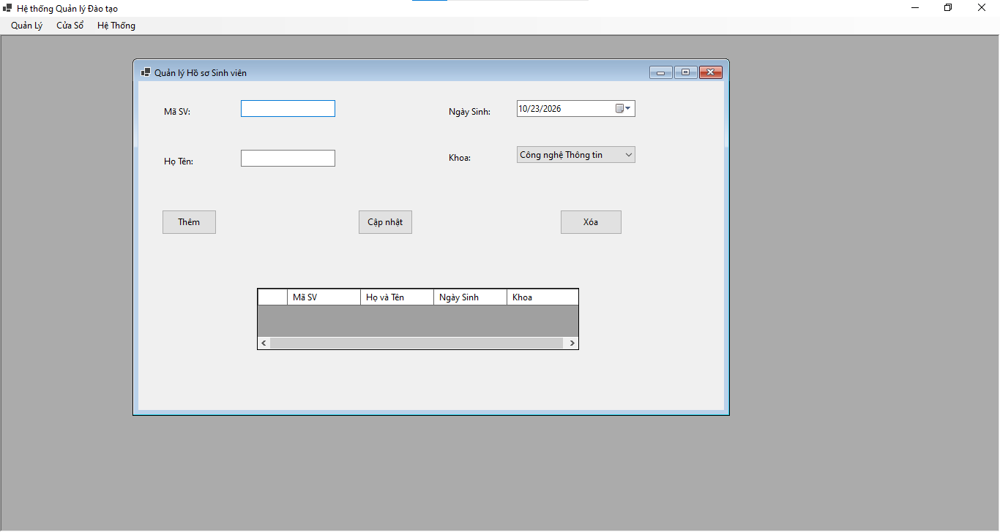
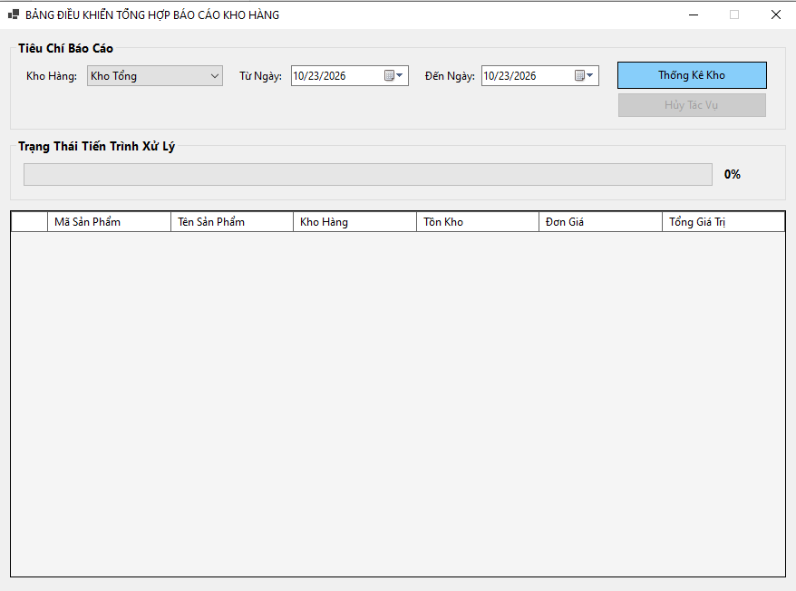
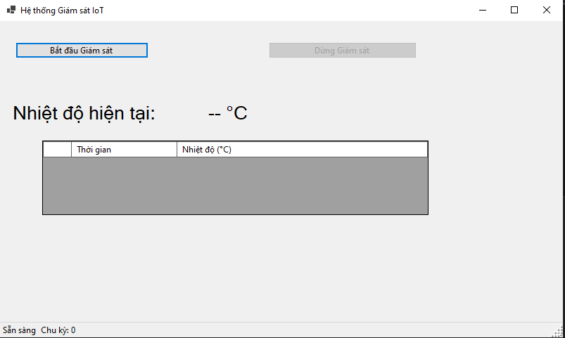
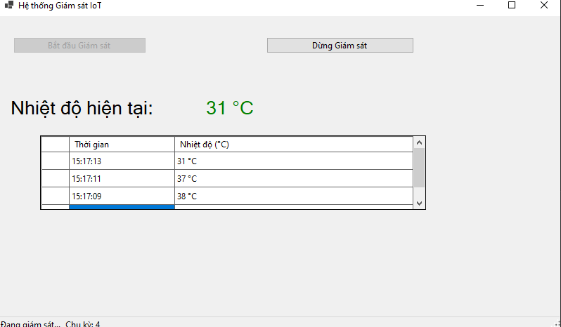

# BÁO CÁO BÀI TẬP TEST 02

## I. THÔNG TIN SINH VIÊN

* **Họ và tên:** Nguyễn Trọng Bảo Long

* **Mã số sinh viên:** 24810320052

* **Lớp học phần:** Lập trình .NET - Mã Lớp: D19QTANM1

* **Link Repository:** https://github.com/BaoLong/LTNET-TEST02_24810320052_NguyenTrongBaoLong.git

## II. DANH SÁCH BÀI TẬP HOÀN THÀNH & TỰ ĐÁNH GIÁ

| Bài tập | Tiêu đề bài tập | Trạng thái | Mức độ hoàn thành (%) | 
| ----- | ----- | ----- | ----- | 
| **Bài 1** | Quản lý Đặt phòng Khách sạn | Hoàn thành | 100% | 
| **Bài 2** | Quản lý Hồ sơ Nhân sự & Thông tin Lương | Hoàn thành | 100% | 
| **Bài 3** | Hệ thống MDI Quản lý Trường học & Đào tạo | Đang hoàn thiện | 50% | 
| **Bài 4** | Bảng Điều khiển Tổng hợp Báo cáo Kho hàng | Hoàn thành | 100% | 
| **Bài 5** | Mô phỏng Giám sát Hệ thống Cảnh báo IoT Real-time | Hoàn thành | 100% | 

## III. MINH HỌA GIAO DIỆN & KỸ THUẬT NỔI BẬT

### 1. Bài 1: Quản lý Đặt phòng Khách sạn

* **Kỹ thuật áp dụng:**

  * Khai báo và cấu hình `DataGridView` chuẩn qua code C# (`AutoGenerateColumns = false`).

  * Quản lý trạng thái đồng bộ 2 chiều bằng `BindingList<T>` và `BindingSource`.

  * Ràng buộc và kiểm tra hợp lệ dữ liệu nhập với `ErrorProvider` (kiểm tra tên khách hàng trống, CCCD 9/12 số hợp lệ, và giá phòng nguyên dương).

* **Hình ảnh minh họa Giao diện:**


*Mô tả: Giao diện chính lúc khởi động.*



*Mô tả: Giao diện khi nạp và hiển thị dữ liệu thành công.*



*Mô tả: ErrorProvider cảnh báo lỗi trực quan khi dữ liệu không thỏa mãn điều kiện nghiệp vụ.*

### 2. Bài 2: Quản lý Hồ sơ Nhân sự & Thông tin Lương

* **Kỹ thuật áp dụng:**

  * Sử dụng `OpenFileDialog` để chọn ảnh chân dung và `SaveFileDialog` để xuất/nhập file danh sách định dạng CSV.

  * Thiết kế thanh điều khiển tiêu chuẩn với `MenuStrip`, `ToolStrip`, và `StatusStrip`.

  * Cập nhật dữ liệu động lên `StatusStrip` (Tổng số nhân viên, Tổng quỹ lương) mỗi khi danh sách có biến động.

* **Hình ảnh minh họa Giao diện:**



*Mô tả: Giao diện chính bài 2*


### 3. Bài 3: Hệ thống MDI Quản lý Trường học & Đào tạo

* **Kỹ thuật áp dụng:**

  * Kiến trúc đa cửa sổ MDI chuẩn mực (`IsMdiContainer = true`).

  * Sử dụng generic kiểm tra danh sách `MdiChildren`, ngăn chặn mở lặp lại Form con và đưa Form đã mở lên trên bằng `.Activate()`.

  * Điều hướng và sắp xếp cửa sổ con linh hoạt: `Cascade` (Xếp tầng), `TileHorizontal` (Ngang), `TileVertical` (Dọc), `CloseAll` (Đóng tất cả).

* **Hình ảnh minh họa Giao diện:**



*Mô tả: Cửa sổ cha MDI điều khiển và quản lý các form con.*

### 4. Bài 4: Bảng Điều khiển Tổng hợp Báo cáo Kho hàng (Async/Await)

* **Kỹ thuật áp dụng:** Lập trình bất đồng bộ `async/await` kết hợp `Task.Run()` đẩy tác vụ nặng xuống Background Thread giữ cho UI luôn mượt mà. Sử dụng tiến trình ngầm cập nhật ProgressBar và hủy tác vụ an toàn bằng `CancellationTokenSource`.


* **Hình ảnh minh họa Giao diện:**



*Mô tả: Giao diện chính bài 4


### 5. Bài 5: Mô phỏng Giám sát Hệ thống Cảnh báo IoT Real-time

* **Kỹ thuật áp dụng:**

  * Vòng lặp chạy ngầm định kỳ (Background Loop) khởi chạy bằng `Task.Run`, cập nhật biến động nhiệt độ cảm biến từ 30°C đến 42°C mỗi 2 giây.

  * Tuân thủ nguyên tắc Cross-Thread Safety trong Windows Forms bằng cách kiểm tra `this.InvokeRequired` và điều phối về UI Thread qua `this.Invoke(new Action(...))`.

  * Không phát sinh ngoại lệ `InvalidOperationException` khi tương tác Control. Cập nhật cảnh báo trực quan đổi màu.

* **Hình ảnh minh họa Giao diện:**



*Mô tả: Giao diện hệ thống giám sát khi ở trạng thái sẵn sàng.*



*Mô tả: Bảng hiển thị nhiệt độ tự đổi màu theo thông số và ghi nhận vào nhật ký khi đang chạy real-time.*


## IV. HƯỚNG DẪN CÀI ĐẶT & CHẠY DỰ ÁN


1. **Clone Repository về máy:**
   ```bash
   git clone https://github.com/Nonqhihi/LTNET_TEST2_24810320052_NguyenTrongBaoLong.git
   ```

2. **Mở Solution:**
  
- Khởi động **Visual Studio 2019** (hoặc phiên bản tương đương hỗ trợ .NET Framework / .NET Core Desktop).
   
- Mở file solution: `src/WinFormsAppSolution.sln` (hoặc mở từng Project `bài1`, `bài2`, `bài3`, `bài4`, `bài5`).

3. **Chọn Project khởi động (Startup Project):**
  
 - Nhấp chuột phải vào Project muốn chấm (ví dụ: `bài1` hoặc `bài5`) trong **Solution Explorer**.
  
 - Chọn **Set as Startup Project**.

4. **Biên dịch & Khởi chạy:**
   
- Nhấn **Ctrl + Shift + B** để Build Solution.
   
- Nhấn **F5** (hoặc chọn nút **Start**) để khởi chạy và kiểm thử chương trình.
